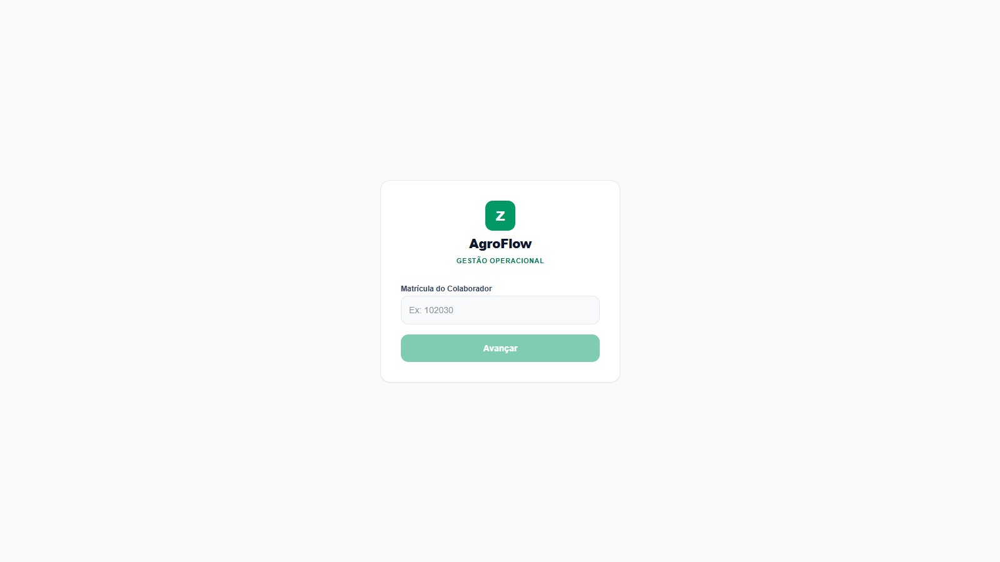

# AgroFlow

Sistema web full-stack desenvolvido para gestão de ordens de serviço, atendimento por setor e manutenção de frotas e equipamentos agrícolas. Construído com foco em responsividade (Mobile-First), tipagem estrita e controle de acesso por perfil.

---

## 📷 Demonstração



---

## Stack

- **Frontend:** Next.js (App Router), React, TypeScript e Tailwind CSS
- **Backend:** Node.js, Fastify e TypeScript
- **Banco de Dados e ORM:** MongoDB e Prisma ORM
- **Autenticação e Segurança:** JWT, RBAC e BcryptJS

## Funcionalidades

- **Autenticação:** Fluxo em duas etapas com validação de matrícula ativa e login por senha com emissão de token JWT.
- **Ordens de Serviço (O.S.):** Criação de ordens por equipamento e frota, agrupamento em O.S. aberta e listagem filtrada por status (`ABERTA` e `FINALIZADA`).
- **Controle por Setor:** Ações de iniciar, pausar, retomar e finalizar atendimento, com cálculo do tempo de manutenção e encerramento automático da O.S. quando todos os setores são finalizados.
- **Cadastros Operacionais:** Gerenciamento de colaboradores, equipamentos e operadores.

## Estrutura do Projeto

```text
agro-flow/
├── client/
│   └── src/
│       ├── app/
│       ├── components/
│       ├── hooks/
│       ├── services/
│       └── types/
└── server/
    └── src/
        ├── config/
        ├── controllers/
        ├── middlewares/
        ├── prisma/
        ├── routes/
        └── services/
```

## Como rodar localmente

Clone o repositório:

```bash
git clone https://github.com/jonatasem/agro-flow.git
cd agro-flow
```

Instale as dependências e inicie o backend:

```bash
cd server
npm install
npx prisma generate
npm run dev
```

Em outro terminal, instale as dependências e inicie o frontend:

```bash
cd client
npm install
npm run dev
```

A aplicação estará disponível em `http://localhost:3000`.

## Contato

- **E-mail:** jonatas.em25@gmail.com
- **GitHub:** [github.com/jonatasem](https://github.com/jonatasem)